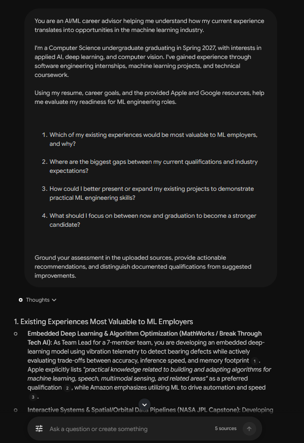
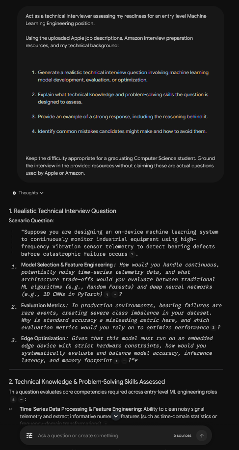
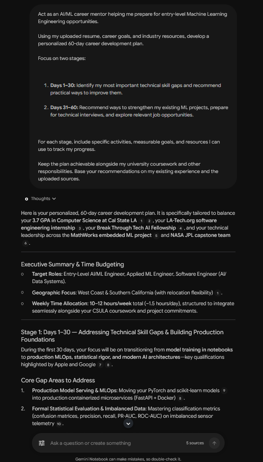

# AI_Pre_Apprenticeship_Notebook_LM

## 1. Project Overview

The AI/ML Career Coach is an AI powered career guidance assistant I made using Google NotebookLM as a part of the LA-Tech.org Internship program.

It is designed to help Computer Science students interested in AI and Machine Learning Engineering better understand industry expectations and prepare for future opportunities. It does this by using industry job descriptions, various learning resources, and personal career information. It provides personalized guidace, technical interview prep, and development recommendations.

**Career Pathway:** AI / ML Engineering

**Built With:** Google NotebookLM

**Program:** LA-Tech.org Rising Technical Internship Program, Fall 2026

## Examples

### Career guidance
I asked my coach to compare my own experience with industry AI/ML engineering expectations, to identify areas of improvement and any ways to strengthen my projects. I provided it with my own career information in order to do this.

### Mock Technical Interview 
I asked my coach to generate me entry level ML engineering questions, explain what it assessed and a sample answer. These were inspired by the positions I provided to it as resources such as a few Apple and Microsoft positions. 

### 30 / 60 Day Career Plan
I asked my coach to outline an achievable plan taking in mind all my activities, responsibilities and coursework, to begin career preparation. 

### Prompt Improvement and Responsible AI Check
**Original Prompt**: How can I improve my chances of becoming a Machine Learning Engineer?

**Improved prompt:** Using my resume, career goals, and the uploaded Apple internship descriptions, identify my two biggest skill gaps for entry-level ML engineering roles. For each gap, recommend one practical improvement I can make within 30 days using my existing projects. Present your recommendations in a table and cite the sources supporting your assessment.

Why it Changed?: I revised my prompt and had it ask for something more source based, with more specifics such as concrete actions, a time frame and structured response instead of broader advice. Overall the result came out a lot more descriptive than it had before, and it was a lot better overall.

### Responsible AI Check

I asked questions like the exact interview rounds, questions, and evaluation criteria for one of Apple's ML internships to test whether or not the coach would notify me or end up hallucinating. In the end it worked as expected and the coach notified me of missing data, outlining that it couldn't find any information on what I had requested.

## 30 / 60 Day Career Plan

As I mentioned before I used my AI/ML coach to organize my steps around technical growth and career prep

Days 1-30: It instructed me to review ML fundamentals, model evaluation, deep learning, and optimization. As well as practicing ML related technical interview questions and try to identify any skills I was missing using job descriptions and other resources.

Days 31-60: Instructed me to improve how I document my existing ML project, review opportunities to strengthen the value of my projects, and practice explaining those technical decisions I took when working on them. As well as researching relevant AI/ML positions while I interview Prep.

All this while it also gave me time to balance all my current responsibilities with school, internships, and etc.

## 8. Reflection
### 1. What was the most useful thing my AI coach did?
I think it really helped me connect both my SWE and ML experience with the expectations described in real job postings. Comparing those sources with what I have helped me more clearly understand what I was missing and what to prioritize.

### 2. What was one limitation or mistake I discovered?
One limitation I found is how the coach is only really able to answer with information available within it's sources. Job descriptions can explain required qualifications without revealing other specifics so I constantly need to verify if the coaches claims are accurate instead of assuming they are right. I could point to the test I did beforehand, when I asked it for several things the source did not have, fortunately it caught the issue but I don't trust it will every time. 

### 3. How could this assistant help someone in a real job?
I think it could help students or even professionals moving into ML engineering with identifying transferable skills, comparing their experience to roles they want, and generally speaking just planning and practicing their development.

### 4. What would I improve in a future version? 
I would most likely add more job descriptions regarding AI specialties, things like computer vision or applied ML. Probably also include more interactive mock interviews with things like follow up questions feedback and maybe a way to track my progress.

## 9. Skills Demonstrated
- Prompt Engineering
- AI Output Evaluation
- Research and Source Curation
- Responsible AI Practices
- GitHub Documentation
- Career Readiness

